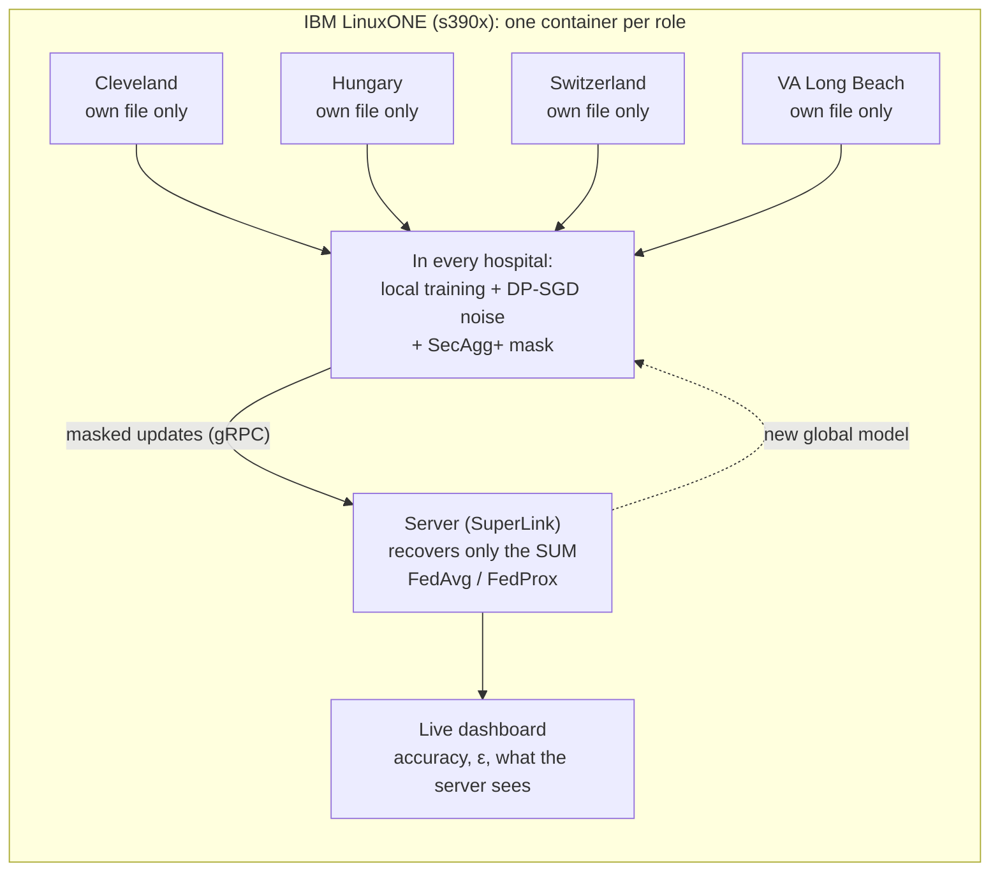

<p align="center"></p>

# Zero Exposure

**Four hospitals train one heart-disease model. No hospital shares a single patient record.**

Privacy-preserving federated learning on IBM LinuxONE, built for the IBM Z Datathon 2026, theme *AI Secured: Innovation Without Exposure*.
Each hospital trains on its own patients and sends only a noise-protected, masked model update. The server can read the sum of the
updates, never one hospital's update.

---

## Why

Hospitals cannot legally pool patient records (HIPAA, GDPR, India's DPDP Act 2023). A small hospital that trains alone on a few hundred
patients gets a weaker model than a large hospital. Zero Exposure lets them learn together while every record stays where it is.

## How it works

Three layers protect every update:

| Layer | Tool | What it does |
|---|---|---|
| Federated learning | [Flower](https://flower.ai) 1.37 | The model travels to each hospital; the data stays. FedAvg or FedProx combines the updates. |
| Differential privacy | [Opacus](https://opacus.ai) 1.6 (DP-SGD) | Clips each patient's influence and adds noise; each hospital's privacy budget ε is tracked with RDP accounting. |
| Secure aggregation | Flower SecAgg+ | Masks each update with random values that cancel only in the sum. |



The data is the public [UCI Heart Disease](https://archive.ics.uci.edu/dataset/45/heart+disease) set, which comes from four real
institutions. We keep each one as a separate federated hospital: Cleveland (303 patients), Hungary (294), Switzerland (123) and
VA Long Beach (200). Each record has 13 clinical features and a heart-disease label.

## Results

All numbers are measured in this repo. "5 seeds" means the mean over 5 random seeds.

| Claim | Result |
|---|---|
| Privacy costs little accuracy | Federated **76.02%** vs centralized **77.84%** (gap 1.8 points, within the ±2.0-point seed spread); FedProx, DP noise 2, SecAgg+ on, ε ≈ 12.2, 5 seeds |
| Differential privacy | Accuracy 0.767 without noise vs 0.758-0.760 at noise 2; max ε 12 at noise 2 and 166 at noise 0.5 (small hospitals make ε large) |
| Secure aggregation is free in accuracy | Same mean accuracy and same ε with SecAgg+ on (0.766 at noise 1, 0.758 at noise 2, 5 seeds); quantization error ~4e-6; +0.4-0.5 s per round |
| The server sees noise | The masked vector (274 values, uint32) passes a chi-square uniformity test |
| Deployment = simulation | Separate processes give exactly the same accuracy, F1 and ε as the simulation (difference 0.0) |
| Runs on s390x | A full SecAgg+ round completes on s390x (big-endian) under QEMU emulation, also in a mixed amd64 + s390x federation |

Sources and more detail: [`CLAUDE.md`](CLAUDE.md) and [`docs/BUILDATHON_PLAYBOOK.md`](docs/BUILDATHON_PLAYBOOK.md) section 3.
Not yet measured: speed on real LinuxONE hardware.

## Quick start

### 1. Get the data (not in git)

Download the four files `processed.{cleveland,hungarian,switzerland,va}.data` into `data/heart_disease/`:

```bash
mkdir -p data/heart_disease && cd data/heart_disease
for h in cleveland hungarian switzerland va; do
  curl -fLO https://archive.ics.uci.edu/ml/machine-learning-databases/heart-disease/processed.$h.data
done
cd ../..
```

### 2a. Docker (recommended; amd64 or s390x)

```bash
docker compose -f deploy/docker-compose.yml up --build
```

Then open http://127.0.0.1:8000 (set `DASHBOARD_PORT=8001` if the port is busy). This starts one SuperLink, four SuperNodes (each
mounts only its own hospital file) and the dashboard. On IBM LinuxONE, follow [`deploy/LINUXONE.md`](deploy/LINUXONE.md): the first
build compiles grpcio and cryptography from source.

### 2b. Python on a laptop (no Docker)

[`requirements.txt`](requirements.txt) pins the versions this repo was tested with (Python 3.14, Windows 11, CPU only).
Install torch first from the CPU index, so Linux does not pull the multi-GB CUDA build:

```bash
python -m venv .venv
.venv/Scripts/python -m pip install torch==2.14.0 --index-url https://download.pytorch.org/whl/cpu   # Linux/macOS: .venv/bin/python
.venv/Scripts/python -m pip install -r requirements.txt
```

| What | Command |
|---|---|
| Live dashboard (simulation mode) | `.venv/Scripts/python -m dashboard.server`, then http://127.0.0.1:8000 |
| Deployment mode, separate processes | `.venv/Scripts/python run_step6_local.py rounds=3 secagg=1 noise=1.0` |
| One simulation run (step 4) | `SECAGG=1 NOISE=1.0 NUM_ROUNDS=3 .venv/Scripts/python step4_heart_secagg.py` |

The dashboard opens with a recorded run (the "golden run"), so every panel has data before you train. **Start live run** trains for
real; **Replay** plays a recording without training.

## Tests

| Test | What it checks | Time |
|---|---|---|
| `test_step3_dp.py` | FedProx changes weights, ε grows monotonically, accountant cross-check, byte-order handling | short |
| `test_step4_secagg.py` | SecAgg off equals step 3; SecAgg on vs off within the quantization bound; clipping range; FedProx μ reaches clients | minutes |
| `dashboard/test_sweeps.py` | The privacy-vs-accuracy data from the sweep files | seconds |
| `test_dashboard.py` | API, live stream, inspector files, masked-vector uniformity, process cleanup | a few minutes |
| `test_step6_deploy.py` | Deployment equals simulation exactly; SecAgg bound; hooks; no leftover processes | ~15 min |

Each test is a plain script that prints `ALL OK`: `.venv/Scripts/python test_step3_dp.py`.

## Repository layout

| Path | Contents |
|---|---|
| `step1_flower_fedavg.py` ... `step4_heart_secagg.py` | The build-up: FedAvg → FedProx on the 4 hospitals → DP-SGD → SecAgg+ (simulation) |
| `step6_heart_deploy.py`, `pyproject.toml` | The same system as a Flower deployment (no Ray; works on s390x) |
| `run_step6_local.py` | Native launcher: SuperLink + 4 SuperNodes as processes |
| `dashboard/` | FastAPI + server-sent events + Chart.js dashboard; `replays/` holds the golden run |
| `deploy/` | Dockerfile, compose files (incl. a mixed amd64/s390x override) and the LinuxONE runbook |
| `results/` | Sweep results behind the trade-off chart |
| `docs/` | Buildathon playbook and the abstract design document |

## Limits (said up front)

- **Threat model:** an honest-but-curious server (follows the protocol, tries to read updates). With 4 hospitals, 3 colluding with the
  server could reveal the 4th's update. SecAgg+ does not replace differential privacy.
- **ε is large** (12 at noise 2) because the hospitals are small; we report it rather than hide it. The ε colour bands on the dashboard are a rule of thumb.
- **Demo shortcuts:** the server container also holds all four files to compute the non-private baselines and the pooled test score
  (evaluation only); gRPC has no TLS; the dashboard has no login (it listens on loopback only); a shared `/runs` volume feeds the inspector view.
- **Not verified yet:** speed and the protobuf C extension on real LinuxONE hardware; runs longer than 1 round on s390x.
- IBM Z features such as Secure Execution and pervasive encryption are **next steps**, not implemented.

## Team and credits

Team **Zero Exposure**. Built with Flower, Opacus, PyTorch, FastAPI and Chart.js; fonts IBM Plex (SIL OFL). Data: Janosi, Steinbrunn,
Pfisterer and Detrano, *Heart Disease*, UCI Machine Learning Repository (1988).
## Licence

Apache License 2.0: see [`LICENSE`](LICENSE). Copyright 2026 Ritik Bhardwaj (Team Zero Exposure).
Third-party files keep their own licences: Chart.js (MIT) in `dashboard/static/vendor/`, IBM Plex fonts (SIL OFL 1.1,
`dashboard/static/vendor/fonts/OFL.txt`). The UCI data is not included in this repository.
