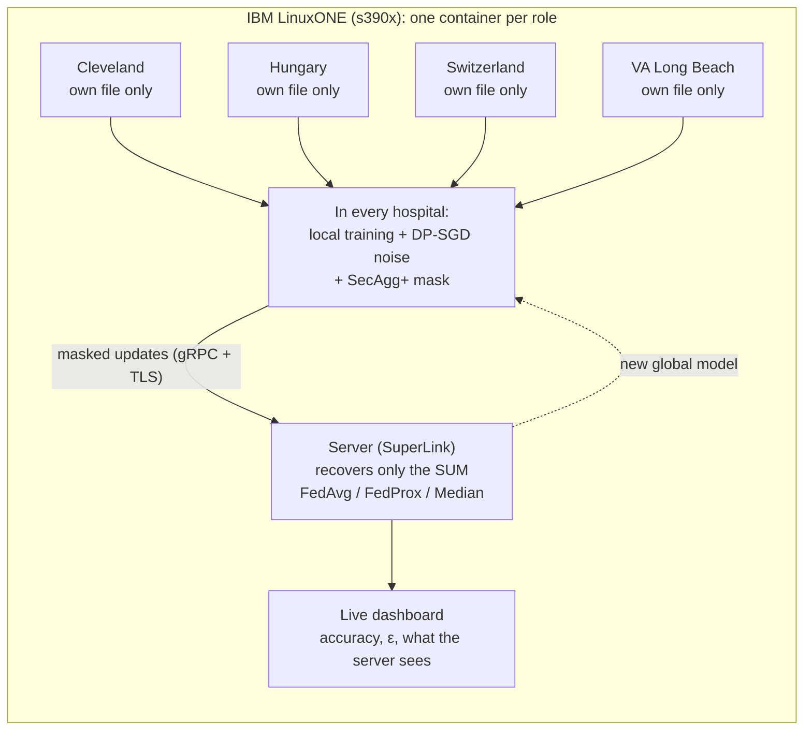

<p align="center"></p>

# Zero Exposure

**Four hospitals train one heart-disease model. No hospital shares a single patient record.**

Privacy-preserving federated learning on IBM LinuxONE, built for the IBM Z Datathon 2026, theme *AI Secured: Innovation Without Exposure*.
Each hospital trains on its own patients and sends only a noise-protected, masked model update. The server can read the sum of the
updates, never one hospital's update. It runs live on IBM LinuxONE (s390x), and it shows what an attacker can and cannot do:
a hospital that poisons its updates, and a curious server that tries to tell which patients were in the training data.

---

## Why

Hospitals cannot legally pool patient records (HIPAA, GDPR, India's DPDP Act 2023). A small hospital that trains alone on a few hundred
patients gets a weaker model than a large hospital. Zero Exposure lets them learn together while every record stays where it is.

## How it works

Three layers protect every update:

| Layer | Tool | What it does |
|---|---|---|
| Federated learning | [Flower](https://flower.ai) 1.37 | The model travels to each hospital; the data stays. FedAvg or FedProx combines the updates. |
| Differential privacy | [Opacus](https://opacus.ai) 1.6 (DP-SGD) | Clips each patient's influence and adds noise; each hospital's privacy budget ε is tracked with RDP accounting. |
| Secure aggregation | Flower SecAgg+ | Masks each update with random values that cancel only in the sum. |
| Encrypted transport | gRPC over TLS | Every link between the server and the hospital containers is encrypted (demo CA made by `deploy/gen_certs.py`). |

On top, an **attack lab**: one hospital can poison its updates (label flip, boost, or both) and the server can run a membership-inference
attack; the median of the updates is the defence. The attacks run both in the simulation and in the real deployment on LinuxONE.



The data is the public [UCI Heart Disease](https://archive.ics.uci.edu/dataset/45/heart+disease) set, which comes from four real
institutions. We keep each one as a separate federated hospital: Cleveland (303 patients), Hungary (294), Switzerland (123) and
VA Long Beach (200). Each record has 13 clinical features and a heart-disease label.

## Results

All numbers are measured in this repo. "5 seeds" means the mean over 5 random seeds.

| Claim | Result |
|---|---|
| Privacy costs little accuracy | Federated **76.02%** vs centralized **77.84%** (gap 1.8 points, within the ±2.0-point seed spread); FedProx, DP noise 2, SecAgg+ on, ε ≈ 12.2, 5 seeds |
| Differential privacy | Accuracy 0.767 without noise vs 0.758-0.760 at noise 2; max ε 12 at noise 2 and 166 at noise 0.5 (small hospitals make ε large) |
| Secure aggregation is free in accuracy | Same mean accuracy and same ε with SecAgg+ on (0.766 at noise 1, 0.758 at noise 2, 5 seeds); quantization error ~4e-6; +0.4-0.5 s per round |
| The server sees noise | The masked vector (274 values, uint32) passes a chi-square uniformity test |
| Deployment = simulation | Separate processes give exactly the same accuracy, F1 and ε as the simulation (difference 0.0) |
| Runs on real LinuxONE | IBM LinuxONE Community Cloud VM (s390x, big-endian, 3 vCPU, Telum `nnpa` flag): image build 17 min 47 s; a 3-round SecAgg+ run with all 4 hospitals in ~3 min, accuracy 0.723, the same as on the laptop; 2.3 GB RAM in use for all 6 containers (17 Oct 2026) |
| Runs across architectures | A mixed amd64 + s390x federation gives the same accuracy as all-s390x (QEMU rehearsal) |
| Poisoning hurts, the median helps | Label flip by one hospital cuts the other hospitals' accuracy 0.763 → 0.669; flip + boost ×10 cuts it to 0.428; the median recovers 0.718 / 0.714 (only with SecAgg+ off). Noise 1, 20 rounds, 5 seeds |
| Attacks on LinuxONE | Flip + boost ran live on LinuxONE with SecAgg+ on (3 rounds): honest-hospital accuracy 0.413, the same as the simulation; SecAgg+ clipped it in 0 rounds |
| Membership inference fails | Loss-threshold attack AUC 0.49-0.50 (a coin flip), even without DP; 0.53 only when overfitted (50 local epochs, no DP) |

Sources and more detail: [`CLAUDE.md`](CLAUDE.md) and [`docs/BUILDATHON_PLAYBOOK.md`](docs/BUILDATHON_PLAYBOOK.md) sections 3 and 5.0.

## Quick start

### 1. Get the data (not in git)

Download the four files `processed.{cleveland,hungarian,switzerland,va}.data` into `data/heart_disease/`:

```bash
mkdir -p data/heart_disease && cd data/heart_disease
for h in cleveland hungarian switzerland va; do
  curl -fLO https://archive.ics.uci.edu/ml/machine-learning-databases/heart-disease/processed.$h.data
done
cd ../..
```

### 2a. Docker (recommended; amd64 or s390x)

```bash
docker compose -f deploy/docker-compose.yml up --build
```

Then open http://127.0.0.1:8000 (set `DASHBOARD_PORT=8001` if the port is busy). This makes the TLS certificates on the first start,
then runs one SuperLink, four SuperNodes (each mounts only its own hospital file and only the CA certificate) and the dashboard.
On IBM LinuxONE, follow [`deploy/LINUXONE.md`](deploy/LINUXONE.md): install `docker.io docker-compose-v2`; the first build compiles
grpcio and cryptography from source (18 min). The dashboard listens on the VM's loopback only; reach it through SSH:
`ssh -L 8800:127.0.0.1:8000 linux1@<vm>`, then http://127.0.0.1:8800 (Windows often reserves port 8000 itself).

### 2b. Python on a laptop (no Docker)

[`requirements.txt`](requirements.txt) pins the versions this repo was tested with (Python 3.14, Windows 11, CPU only).
Install torch first from the CPU index, so Linux does not pull the multi-GB CUDA build:

```bash
python -m venv .venv
.venv/Scripts/python -m pip install torch==2.14.0 --index-url https://download.pytorch.org/whl/cpu   # Linux/macOS: .venv/bin/python
.venv/Scripts/python -m pip install -r requirements.txt
```

| What | Command |
|---|---|
| Live dashboard (simulation mode) | `.venv/Scripts/python -m dashboard.server`, then http://127.0.0.1:8000 |
| Deployment mode, separate processes | `.venv/Scripts/python run_step6_local.py rounds=3 secagg=1 noise=1.0` |
| Deployment with an attacker | `.venv/Scripts/python run_step6_local.py rounds=3 secagg=1 attack=flipboost` (add `attack-dir=<absolute folder>` for the membership test) |
| One simulation run (step 4) | `SECAGG=1 NOISE=1.0 NUM_ROUNDS=3 .venv/Scripts/python step4_heart_secagg.py` |
| One attack simulation (step 7) | `ATTACK=labelflip AGG=median SECAGG=0 NUM_ROUNDS=3 .venv/Scripts/python step7_heart_attacks.py` |

The dashboard opens with a recorded run (the "golden run"), so every panel has data before you train. **Start live run** trains for
real; **Replay** plays a recording without training.

## Tests

| Test | What it checks | Time |
|---|---|---|
| `test_step3_dp.py` | FedProx changes weights, ε grows monotonically, accountant cross-check, byte-order handling | short |
| `test_step4_secagg.py` | SecAgg off equals step 3; SecAgg on vs off within the quantization bound; clipping range; FedProx μ reaches clients | minutes |
| `dashboard/test_sweeps.py` | The privacy-vs-accuracy data from the sweep files | seconds |
| `test_dashboard.py` | API, live stream, inspector files, masked-vector uniformity, process cleanup | a few minutes |
| `test_step6_deploy.py` | Deployment equals simulation exactly; SecAgg bound; hooks; TLS refuses plaintext and foreign CAs; no leftover processes | ~15 min |
| `test_step7_attacks.py` | No attack equals step 4; each attack and the median behave as designed; bad combinations refused | ~12 min |
| `test_step8_deploy_attacks.py` | Attacks in the deployment equal the step 7 simulation exactly (training and attack results) | ~15 min |

Each test is a plain script that prints `ALL OK`: `.venv/Scripts/python test_step3_dp.py`.

## Repository layout

| Path | Contents |
|---|---|
| `step1_flower_fedavg.py` ... `step4_heart_secagg.py` | The build-up: FedAvg → FedProx on the 4 hospitals → DP-SGD → SecAgg+ (simulation) |
| `step6_heart_deploy.py`, `pyproject.toml` | The same system as a Flower deployment (no Ray; works on s390x) |
| `step7_heart_attacks.py` | Attack lab in simulation: poisoning hospital, curious server (membership inference), median defence |
| `step8_heart_deploy_attacks.py` | The attack lab in the deployment, so it runs on LinuxONE; the app `pyproject.toml` runs |
| `run_step6_local.py` | Native launcher: SuperLink + 4 SuperNodes as processes (TLS on) |
| `dashboard/` | FastAPI + server-sent events + Chart.js dashboard; `replays/` holds the golden run |
| `deploy/` | Dockerfile, compose files (incl. a mixed amd64/s390x override) and the LinuxONE runbook |
| `results/` | Sweep results behind the trade-off chart |
| `docs/` | Buildathon playbook, the abstract design document, and notes from the LinuxONE prep session |

## Limits (said up front)

- **Threat model:** an honest-but-curious server (follows the protocol, tries to read updates). With 4 hospitals, 3 colluding with the
  server could reveal the 4th's update. SecAgg+ does not replace differential privacy.
- **ε is large** (12 at noise 2) because the hospitals are small; we report it rather than hide it. The ε colour bands on the dashboard are a rule of thumb.
- **Demo shortcuts:** the server container also holds all four files to compute the non-private baselines, the pooled test score and
  the membership test (evaluation only); the dashboard has no login (it listens on loopback only); a shared `/runs` volume feeds the
  inspector view and the attack side channel.
- **TLS** uses a self-made demo CA and authenticates only the server: it encrypts the links but does not stop an unknown hospital from joining.
- **Attacks:** SecAgg+ and the median defence exclude each other (the median needs each update in the clear), so with SecAgg+ on there
  is no defence against a poisoning hospital. The membership attack fails even without DP, so the demo cannot show DP stopping it.
- **On real LinuxONE** every Flower process crashes at interpreter exit (pure-Python protobuf, used because the C extension crashed under
  emulation); the work is already done by then, so judge a run by its events file. Runs measured there so far: 3 rounds.
- IBM Z features such as Secure Execution and pervasive encryption are **next steps**, not implemented.

## Team and credits

Team **Zero Exposure**. Built with Flower, Opacus, PyTorch, FastAPI and Chart.js; fonts IBM Plex (SIL OFL). Data: Janosi, Steinbrunn,
Pfisterer and Detrano, *Heart Disease*, UCI Machine Learning Repository (1988).
## Licence

Apache License 2.0: see [`LICENSE`](LICENSE). Copyright 2026 Ritik Bhardwaj (Team Zero Exposure).
Third-party files keep their own licences: Chart.js (MIT) in `dashboard/static/vendor/`, IBM Plex fonts (SIL OFL 1.1,
`dashboard/static/vendor/fonts/OFL.txt`). The UCI data is not included in this repository.
